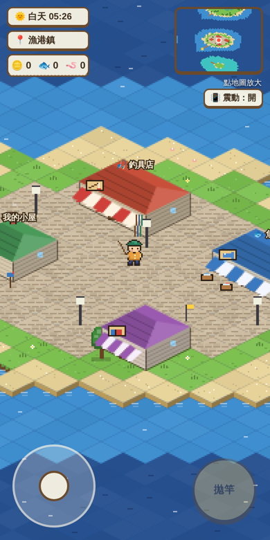
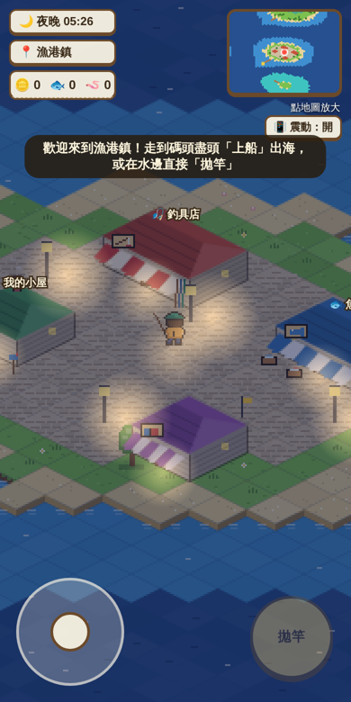
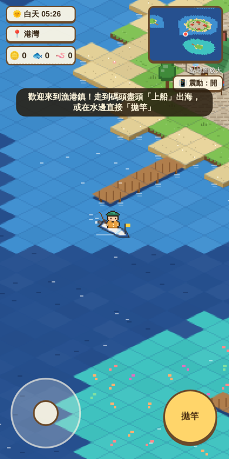
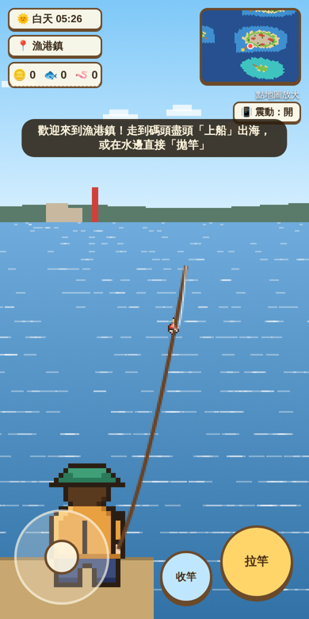
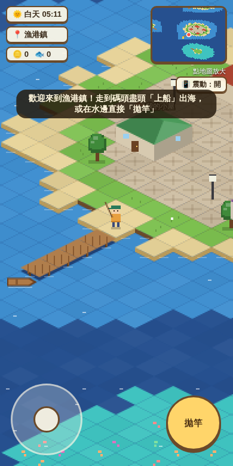
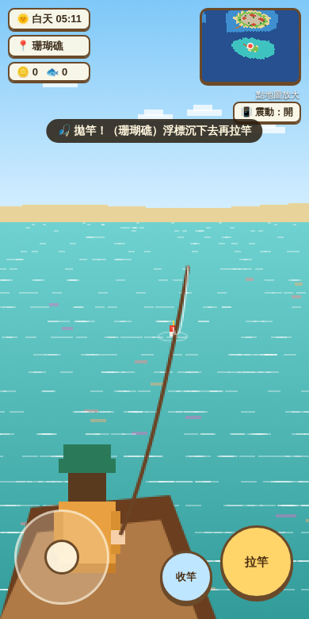
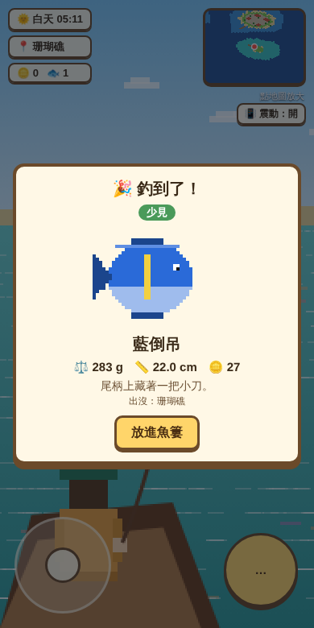
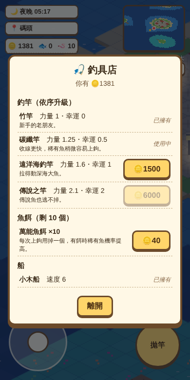
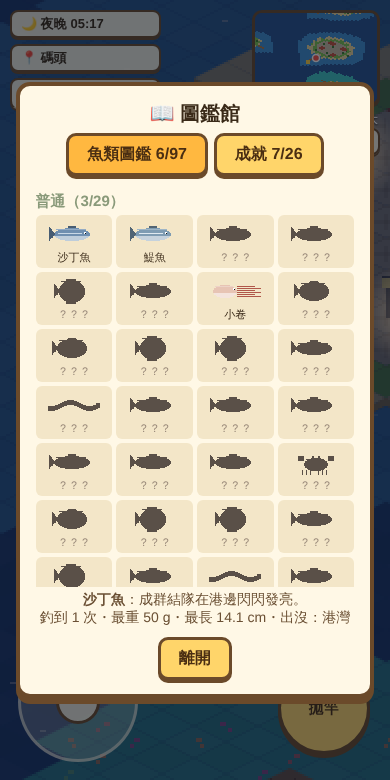
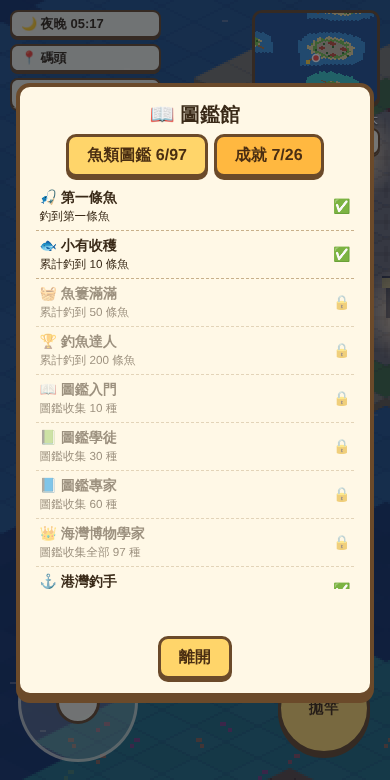

# 🎣 海灣釣魚日記（像素風 2.5D 釣魚遊戲）

老闆主單：Issue #39（任務中心 `tasks/tmvrn8znr`）。目前是**核心雛形**（Issue #41）。

## 怎麼開
直接用瀏覽器打開 `games/fishing/index.html`（手機、電腦都可以，雙擊開檔也能玩）。

- **移動**：左下角搖桿（電腦：方向鍵／WASD）
- **上船／下船／進入建築**：右下藍色小按鈕（電腦：E）
- **拋竿／拉竿／收線**：右下黃色大按鈕（電腦：空白鍵）
- **地圖**：點右上角小地圖放大（電腦：M）
- 網址加 `?time=dawn|day|dusk|night` 可以直接看某個時段（測試用）

## 玩法
1. 從漁港鎮走到碼頭盡頭「上船」，用搖桿自己開船到不同海域。
2. 面向水面按「拋竿」：畫面不切視窗，直接轉成**第三人稱背後視角**，看得到浮標浮在水面上。
3. 浮標小抖動是魚在試探，**整個沉下去**才按「拉竿」；太早拉魚會跑。咬鉤時會：畫面邊框閃黃光、浮標上方跳出大「！」、拉竿按鈕變橘色跳動、發出「咚咚」音效；Android 手機還會震動（iPhone 的網頁不能震動，所以 iPhone 上震動開關會自動隱藏）。右上角可以關音效。
4. 上鉤後「按住收線」，魚掙扎時張力會衝高，太高就放手，不然線會斷；把距離拉到 0 就釣到了。釣到時角色會轉過來把魚捧高（背後亮起稀有度顏色的光圈），配上「登登登 登登」勝利音效，接著跳出釣獲卡片（點一下可以跳過動畫）。
5. 釣到的魚有稀有度、重量、長度、售價，放進魚簍；第一次釣到會登錄圖鑑。
6. 回漁港鎮：**魚市**賣魚換錢 → **釣具店**買更好的釣竿（收線更快、稀有魚更容易上鉤）、魚餌、升級船 → **圖鑑館**看圖鑑與成就 → **我的小屋**看統計。
7. 遊戲每 10 秒與離開頁面時自動存在這台裝置（換手機或清除瀏覽器資料會重來）。

## 區域與魚
| 區域 | 在哪 | 說明 |
|---|---|---|
| 港灣 | 各島近岸 | 城鎮碼頭附近的海 |
| 深海 | 離岸 5 格以上的海 | 大型魚與傳說海怪 |
| 珊瑚礁 | 地圖東南（珊瑚小島四周） | 熱帶魚 |
| 翠湖 | 西北森林島中間的湖（上岸走過去，從岸邊釣） | 淡水魚 |
| 溪谷 | 東北山島的溪（有木橋） | 溪流魚 |

魚種資料：`data/fish.json`（97 種，見 `data/README.md`）。依**現實時間**分清晨／白天／黃昏／夜晚，不同時段出現的魚不同、景色也不同（夜晚有路燈、燈塔與窗戶燈光）。

## 目前進度
| 功能 | 狀態 |
|---|---|
| 2.5D 像素島嶼地圖、城鎮、五座島、五種水域 | ✅ |
| 觸控搖桿、自己開船（有慣性） | ✅ |
| 小地圖＋大地圖、進入區域提示 | ✅ |
| 不切視窗的浮標釣魚＋第三人稱視角、假咬鉤、拉扯張力 | ✅ |
| 手機震動（咬鉤、掙扎、釣到、斷線；右上可關） | ✅（iPhone Safari 不支援網頁震動，Android 可以） |
| 現實時間四時段景色 | ✅ |
| 97 種魚的像素圖 | 🟡 目前用程式畫的暫用圖；GPT 正在畫（2026-006，Issue #42），放到 `assets/fish/<id>.png` 後自動換上 |
| 主角、船、建築正式美術 | ✅ 美術部像素美術（`art.js`，Issue #43）：主角走路動畫、拋竿／拉竿背影、三種船、建築裝飾、地面與水面、浮標 |
| 魚市賣魚、釣具店（4 支釣竿、魚餌、3 種船） | ✅（Issue #44） |
| 魚類圖鑑（沒釣到的是剪影＋出沒提示）、26 個成就 | ✅ 在「圖鑑館」 |
| 自動存檔（這台裝置；小屋可看統計） | ✅ |
| 發布到老闆的 GitHub 遊戲頁 | 🟡 Issue #45 |

## 美術（Issue #43）
全部用程式畫，不用外部素材，放在 `art.js`（`window.ART`）。`index.html` 的 `drawPerson`、`drawBoat`、`drawBuilding`、`drawThird` 有 `window.ART` 就用新圖，沒有就退回原本的暫用圖。
- 主角：12×19 像素字元圖，正面／背面 × 站立／跨步／併腳三格，面向左時左右翻轉；坐船時只畫上半身。
- 第三人稱背影：16×26 像素，姿勢 `idle`（握竿）、`cast`（拋竿舉手）、`pull`（拉竿雙手上提）。
- 船：依 `prog.boatLv` 換外觀（小木船有船槳、馬達小艇有引擎、遠洋快艇有擋風玻璃），開船時有尾跡。
- 建築：條紋雨遮、招牌圖示、釣竿架、魚箱、煙囪炊煙、花箱、信箱、旗子；牆面木板紋與屋瓦線。

| 白天城鎮 | 夜晚城鎮 | 遠洋快艇 | 第三人稱釣魚 |
|---|---|---|---|
|  |  |  |  |

## 給接手的部門
- 遊戲狀態在 `state`（`coins`、`bag`、`rod{power,luck}`），進度在 `prog`（圖鑑、成就、統計、裝備）；存檔鍵 `bay-fishing-save-v1`。
- 釣竿 `RODS`、船 `BOATS`、魚餌 `BAIT`、成就 `ACH` 都是表格，調價格或加成就改表格即可。
- 建築在 `BUILDINGS`，進入時呼叫 `openBuilding(b)`。
- 改魚種請改 `data/build_fish.py` 再執行，會同時更新 `fish.json` 與 `fish.js`。

| 手機：城鎮 | 手機：第三人稱釣魚 | 手機：釣到了 |
|---|---|---|
|  |  |  |
| 釣具店 | 圖鑑 | 成就 |
|  |  |  |

## 狀態
- **🤢 暈船**：待在船上會慢慢頭暈（深海、開快船、夜晚更容易暈）。先出現「😵 有點頭暈」，再久一點就會暈船：整個畫面跟著搖晃、蓋上淡綠色，咬鉤後能拉竿的時間也短一點。
  - 上岸休息就會慢慢好。
  - 釣具店可以買**暈船藥**（🪙30／3 顆）；暈船時點左上角的狀態標籤就會吃藥，立刻不暈，3 分鐘內不會再暈。
- 之後要加新狀態，寫在 `index.html` 的「狀態」區塊（`updateSick` 旁邊）。

## 背景音樂
- 四首原創曲輪播，每首播兩遍換下一首，換歌時畫面上方會顯示曲名：🎵 港口的午後、海風輕輕吹、夜釣的星空、溪谷晨光。
- 音樂是 `music.js` 用程式即時合成的，不用音檔、沒有版權問題。想加新歌就在 `TRACKS` 加一首（旋律寫法見檔案開頭說明）。
- 右上角「🎵 音樂」可以開關（會記住設定）；iPhone 要先點一下畫面才會開始播；切到別的 App 會自動暫停。

## 徽章收集冊
- 圖鑑館的「🏅 徽章收集冊」：26 枚徽章分銅、銀、金、彩虹四種等級，還沒拿到的是灰色「？」，點一下看條件。
- 得到成就時會跳出徽章轉進來的畫面和音效；同時拿到好幾枚會一枚一枚跳。釣魚時會等釣獲卡片關掉才跳。
- 等級設定在 `index.html` 的 `TIER`。

## 換裝
- **我的小屋 → 🪞 換裝**：帽子、髮型、眼鏡、鬍子、衣服、褲子六個部位，點一下就換，左邊有預覽。地圖小人、釣魚背影、捧魚正面都會一起換。
- 一開始只有初始款（綠漁夫帽、棕短髮、黃雨衣、牛仔褲，可以選不戴帽子／眼鏡／鬍子）。
- 其他款式要到別的島買（可以先試穿）：
  - 🎩 **森林服飾店**（翠湖森林島碼頭旁）：帽子、眼鏡、鬍子
  - 👕 **山谷造型屋**（溪谷山島碼頭旁）：髮型、衣服、褲子
- 新徽章：👒 第一件新衣（銅）、🕶️ 時尚達人（收集 10 件，金）。
- 想加新款式：在 `art.js` 的 `WARDROBE` 加一筆（顏色、形狀、價錢、在哪間店賣）。

## 天氣與海象
- 天氣照現實時間每 15 分鐘換一次（大家同一時間看到的天氣一樣）：☀️ 晴天、☁️ 多雲、🌧️ 下雨、⛈️ 暴雨、🌊 大浪、🌀 颱風（約 6% 機率）。
- 左上角時間標籤會顯示目前天氣，**點一下看天氣預報**（下一段天氣是什麼）；颱風來之前 3 分鐘會有颱風警報。
- 影響：
  - 下雨／暴雨：魚咬得比較快；暴雨、颱風會打雷閃電；雨聲音效。
  - 大浪／颱風：船會被浪推著走、畫面隨浪搖、更容易暈船、拉魚時張力升得比較快。
  - 漂流物：海上會漂來漂流木、木箱、漂流瓶（有紙條）、颱風寶箱，開船經過就會撈起來（金幣、魚餌、暈船藥）。天氣越差漂來越多，小地圖上是黃色小點。
- **天氣限定魚 8 種**（圖鑑變 105 種）：漂流藻魚、雨香魚、浪尖飛魚、雨紋鯉、漩渦鯛、雷光鰻、颱風旗魚、傳說的**颱風海龍**（只在颱風天的深海）。
- 新徽章：🌧️ 雨中垂釣（銅）、🌀 颱風勇者（金）、⚡ 天氣限定（銀）、🪵 海上撿寶（銀）。
- 測試用：網址加 `?weather=typhoon`（sunny／cloudy／rain／storm／waves／typhoon）。

## 🎒 背包
左上角「🎒 背包」：魚簍裡每條魚（圖、稀有度、重量、長度、價錢、總值）、道具（金幣、魚餌、暈船藥、釣竿、船）、狀態（暈眩值、防暈藥效、天氣、評比報名狀況）。

## 🏆 金鱗島・釣魚協會評比大賽
- 新島「**金鱗島**」在漁港鎮正北方，開船往上就到；碼頭旁是「🏆 釣魚協會」。
- **每天 20:00**（現實時間）舉行魚的評比大賽：開賽前到協會交一條魚報名（每場一條，交了就被協會收走、不會還）。過了 20:00 就是報名明天那場。
- 每場 **10 條魚**：玩家的魚＋協會會員（電腦）補滿。以後多人連線時，真人越多電腦越少（`CONTEST_SIZE`、`npcEntries`）。同一天大家看到的電腦參賽者都一樣。
- **評分：重量 25%＋長度 25%＋稀有度 50%**。重量、長度跟同場最重／最長的比（用對數，避免超大魚把差距拉太開）；稀有度：普通 20%、少見 40%、稀有 60%、史詩 80%、傳說 100%。
- 獎金：🥇🪙800、🥈🪙500、🥉🪙300、其他🪙50；協會可以看上一場排名和自己的參賽紀錄。
- **頒獎動畫**：20:00 一到，正在玩的人都會強制播放 2D 像素頒獎動畫——會長（船長帽、白鬍子）把獎盃交給冠軍，冠軍的魚擺在前面的展示台，彩帶飄下；看完點一下看完整排名。正在等魚咬鉤會被打斷，正在收線或看釣獲卡片則會等結束再播。有報名但當時不在的人，下次打開遊戲會補看。
- 新徽章：🎫 初次參賽（銅）、🎖️ 登上頒獎台（銀）、🏆 評比冠軍（金）。
- 測試用：網址加 `?contest=19:30` 可以把比賽時間改成 19:30。

